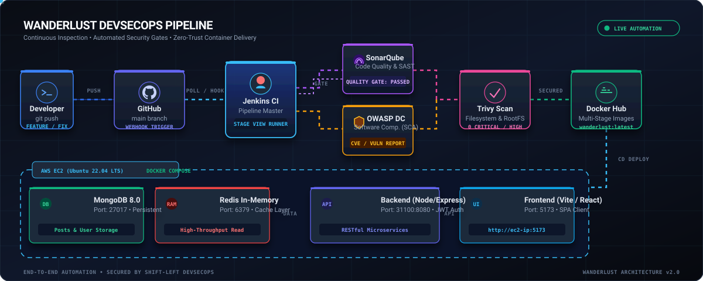
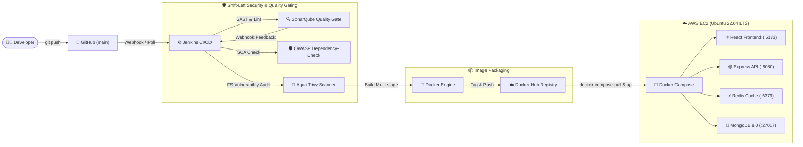

# 🌍 Wanderlust — Enterprise DevSecOps CI/CD Platform

[](https://jenkins.io)
[](https://www.docker.com/)
[](https://www.sonarqube.org/)
[](https://owasp.org/)
[](https://www.aquasec.com/products/trivy/)
[](https://aws.amazon.com/ec2/)
[](https://nodejs.org)

> **Wanderlust** is a production-grade full-stack travel blogging platform engineered with a strict **Shift-Left DevSecOps** philosophy. Every code commit undergoes automated static analysis, vulnerability verification, container hardening, and zero-downtime deployment orchestration.

---

## ⚡ Live Moving Pipeline Architecture

The animated pipeline architecture below illustrates the continuous automated delivery loop with real-time moving data-packets across all stages—from local developer push to cloud containerization:

<p align="center">
  
</p>

> 💡 **Interactive Live Simulation**: Open the interactive canvas simulation with real-time particle controls and terminal log inspection in your browser:  
> 👉 [Open `Assets/pipeline-live-visualization.html`](./Assets/pipeline-live-visualization.html)

---

## 🏗️ System Architecture & Workflow



---

## 🧩 Technology Stack

| Layer | Technology | Details |
| :--- | :--- | :--- |
| **Frontend** | React 18, Vite, TypeScript, TailwindCSS | Single Page Application with dynamic theme switching and optimistic UI rendering |
| **Backend API** | Node.js 24, Express, JWT, Bcrypt | REST API with token authentication, route throttling, and data validation |
| **Database** | MongoDB 8.0 & Mongoose ODM | Document database persisted via host volume mounts |
| **Cache Layer** | Redis 7.0 In-Memory Data Store | Caching frequent blog post queries for sub-millisecond retrieval |
| **Continuous Integration** | Jenkins Declarative Pipeline | Multi-stage pipeline automation with automated tool provisioning |
| **Continuous Delivery** | GitHub Actions & Docker Compose | Redundant automated workflow for build, test, and container push |
| **Static Code Analysis (SAST)** | SonarQube Server & Scanner | Automated code smell, bug, and vulnerability detection with Quality Gate threshold |
| **Software Composition (SCA)** | OWASP Dependency-Check | Known CVE vulnerability analysis on third-party npm packages |
| **Vulnerability Scanner** | Aqua Security Trivy | Filesystem and container rootfs CVE analysis before container release |
| **Container Engine** | Docker & Docker Compose | Multi-stage Dockerfiles minimizing attack surface and image footprints |
| **Hosting Cloud** | AWS EC2 (Ubuntu Linux) | Cloud infrastructure running compute, caching, databases, and CI agents |

---

## 🔐 DevSecOps Pipeline Stages

The automated Jenkins declarative pipeline executes 6 deterministic stages:

```
[Clone Code] ──▶ [SonarQube Analysis] ──▶ [OWASP Check] ──▶ [Quality Gate] ──▶ [Trivy Scan] ──▶ [Deploy Containers]
```

1. **Clone Code from GitHub**: Checks out the target repository branch using authenticated SCM credentials.
2. **SonarQube Quality Analysis**: Runs `sonar-scanner` checking code coverage, duplicates, technical debt, and security hotspots.
3. **OWASP Dependency-Check**: Scans backend and frontend dependencies (`package.json` / `package-lock.json`) against the NIST NVD vulnerability database.
4. **Sonar Quality Gate Scan**: Jenkins blocks pipeline execution until SonarQube returns a successful Quality Gate webhook.
5. **Trivy File System Scan**: Audits filesystem permissions, root dependencies, and unpatched CVEs, outputting an HTML security report.
6. **Deploy using Docker Compose**: Invokes `docker-compose up -d` to spawn or hot-reload backend, frontend, MongoDB, and Redis containers.

---

## 📋 Complete AWS EC2 Setup & Installation Guide

### 1. Launch AWS EC2 Instance & Open Inbound Ports
Launch an **Ubuntu 22.04 / 24.04 LTS** instance (Recommended: `t2.large` or `t3.large`, 4 vCPUs, 8GB RAM, 30GB EBS).

Configure the **Security Group** with the following inbound rules:

| Type | Port Range | Protocol | Purpose |
| :--- | :--- | :--- | :--- |
| **SSH** | `22` | TCP | Remote EC2 Administration |
| **Custom TCP** | `8080` | TCP | Jenkins Automation Server / Express API |
| **Custom TCP** | `9000` | TCP | SonarQube Web Dashboard |
| **Custom TCP** | `5173` | TCP | Wanderlust React Frontend Client |
| **Custom TCP** | `31100` | TCP | Backend Express Exposed Port |
| **Custom TCP** | `27017` | TCP | MongoDB Database Port |
| **Custom TCP** | `6379` | TCP | Redis In-Memory Cache |

---

### 2. Install Docker & Add User to Group
Connect via SSH to your Ubuntu instance and run:

```bash
# Update package repositories
sudo apt-get update -y

# Install Docker engine
sudo apt-get install docker.io -y

# Add ubuntu user to docker group (avoid sudo for docker commands)
sudo usermod -aG docker ubuntu && newgrp docker

# Verify Docker daemon is running
docker ps
```

---

### 3. Install Jenkins & Java 17
```bash
# Install Java OpenJDK 17 Runtime & Fontconfig
sudo apt-get update -y
sudo apt-get install fontconfig openjdk-17-jre -y

# Add Jenkins official Debian repository key
sudo wget -O /usr/share/keyrings/jenkins-keyring.asc \
  https://pkg.jenkins.io/debian-stable/jenkins.io-2023.key

# Add Jenkins repository to APT sources
echo "deb [signed-by=/usr/share/keyrings/jenkins-keyring.asc] \
  https://pkg.jenkins.io/debian-stable binary/" | sudo tee \
  /etc/apt/sources.list.d/jenkins.list > /dev/null

# Install and start Jenkins service
sudo apt-get update -y
sudo apt-get install jenkins -y
sudo systemctl enable --now jenkins
sudo systemctl status jenkins
```

Access Jenkins in your browser: `http://<EC2_PUBLIC_IP>:8080`  
Retrieve the initial administrator password:
```bash
sudo cat /var/lib/jenkins/secrets/initialAdminPassword
```

Install the required plugins:
- **SonarQube Scanner**
- **Sonar Quality Gates**
- **OWASP Dependency-Check**
- **Docker & Docker Pipeline**

---

### 4. Deploy SonarQube Server
Run the official SonarQube Community LTS image inside Docker:

```bash
docker run -itd \
  --name SonarQube-Server \
  -p 9000:9000 \
  --restart unless-stopped \
  sonarqube:lts-community
```

- Access SonarQube dashboard: `http://<EC2_PUBLIC_IP>:9000`
- Default login: Username `admin`, Password `admin` (change upon initial sign-in).

#### Configure SonarQube ⇄ Jenkins Integration
1. **Create Webhook in SonarQube**:
   - Navigate to: **Administration** ➔ **Configuration** ➔ **Webhooks** ➔ **Create**
   - **Name**: `Jenkins`
   - **URL**: `http://<EC2_PUBLIC_IP>:8080/sonarqube-webhook/`
2. **Generate Token in SonarQube**:
   - Go to: **Administration** ➔ **Security** ➔ **Users** ➔ Select user ➔ **Tokens** ➔ Click Generate.
   - Copy the generated token string.
3. **Register Token in Jenkins**:
   - Navigate to: **Manage Jenkins** ➔ **Credentials** ➔ **System** ➔ **Global credentials** ➔ **Add Credentials**
   - **Kind**: Secret text
   - **Secret**: `<Pasted SonarQube Token>`
   - **ID**: `Sonar`
4. **Configure SonarQube Server in Jenkins**:
   - Go to: **Manage Jenkins** ➔ **System** ➔ **SonarQube servers** ➔ **Add SonarQube**
   - **Name**: `Sonar`
   - **Server URL**: `http://<EC2_PUBLIC_IP>:9000`
   - **Server authentication token**: Select `Sonar` credential.
5. **Install SonarQube Scanner Tool**:
   - Go to: **Manage Jenkins** ➔ **Tools** ➔ **SonarQube Scanner installations** ➔ **Add SonarQube Scanner**
   - **Name**: `Sonar` (select latest version & check "Install automatically").
6. **Install OWASP Dependency-Check Tool**:
   - Go to: **Manage Jenkins** ➔ **Tools** ➔ **Dependency-Check installations** ➔ **Add Dependency-Check**
   - **Name**: `dc` (check "Install automatically" from github.com).

---

### 5. Install Aqua Trivy Security Scanner
```bash
# Add Trivy package repository
sudo apt-get install wget apt-transport-https gnupg lsb-release -y
wget -qO - https://aquasecurity.github.io/trivy-repo/deb/public.key | sudo apt-key add -
echo deb https://aquasecurity.github.io/trivy-repo/deb $(lsb_release -sc) main | sudo tee -a /etc/apt/sources.list.d/trivy.list

# Install Trivy CLI
sudo apt-get update -y
sudo apt-get install trivy -y

# Verify Trivy installation
trivy --version
```

---

## 📜 Declarative Jenkins Pipeline (`Jenkinsfile`)

Create a new **Pipeline** item in Jenkins named `wanderlust-CICD`, configure the GitHub Hook Trigger for GITScm polling, and supply the declarative script:

```groovy
pipeline {
    agent any

    environment {
        SONAR_HOME = tool "Sonar"
    }

    stages {
        stage("Clone Code From GitHub") {
            steps {
                git url: "https://github.com/santanuroul123/wanderlust", branch: "main"
            }
        }

        stage("SonarQube Quality Analysis") {
            steps {
                withSonarQubeEnv("Sonar") {
                    sh """
                        $SONAR_HOME/bin/sonar-scanner \
                          -Dsonar.projectName=wanderlust \
                          -Dsonar.projectKey=wanderlust
                    """
                }
            }
        }

        stage("OWASP Dependency Check") {
            steps {
                dependencyCheck additionalArguments: '--scan ./', odcInstallation: 'dc'
                dependencyCheckPublisher pattern: '**/dependency-check-report.xml'
            }
        }

        stage("Sonar Quality Gate Scan") {
            steps {
                timeout(time: 2, unit: "MINUTES") {
                    waitForQualityGate abortPipeline: false
                }
            }
        }

        stage("Trivy File System Scan") {
            steps {
                sh "trivy fs --format table -o trivy-fs-report.html ."
            }
        }

        stage("Deploy using Docker Compose") {
            steps {
                sh "docker-compose up -d --build"
            }
        }
    }

    post {
        always {
            cleanWs()
        }
    }
}
```

---

## 🚀 Local Development & Quickstart

You can also run the entire microservices stack locally with a single command:

```bash
# 1. Clone repository
git clone https://github.com/santanuroul123/wanderlust.git
cd wanderlust-DevSecOps

# 2. Start all services via Docker Compose
docker-compose up -d

# 3. Inspect container health
docker-compose ps
```

### Service Endpoints

- 🌐 **Frontend Web Client**: [http://localhost:5173](http://localhost:5173)
- 🔌 **Backend REST API**: [http://localhost:8080](http://localhost:8080) (or host exposed [http://localhost:31100](http://localhost:31100))
- 🍃 **MongoDB Database**: `mongodb://localhost:27017`
- ⚡ **Redis Cache**: `localhost:6379`
- 📊 **SonarQube Quality Dashboard**: [http://localhost:9000](http://localhost:9000)
- ⚙️ **Jenkins Automation Console**: [http://localhost:8080](http://localhost:8080)

---

## 📁 Repository Directory Structure

```plaintext
wanderlust-DevSecOps/
├── .github/
│   └── workflows/
│       ├── ci.yml                 # GitHub Actions CI (Test, Quality, Trivy)
│       └── cd.yml                 # GitHub Actions CD (Docker Hub multi-arch push)
├── Assets/
│   ├── devsecops-pipeline.svg     # Animated Live SVG Pipeline Diagram
│   └── pipeline-live-visualization.html # Interactive Canvas & Particle Simulation
├── backend/
│   ├── api/                       # API route entrypoints
│   ├── config/                    # MongoDB & Redis configurations
│   ├── controllers/               # Auth & Post business logic
│   ├── models/                    # Mongoose schemas (User, Post)
│   ├── services/                  # In-memory Redis caching service
│   ├── tests/                     # Integration and unit tests
│   ├── Dockerfile                 # Multi-stage optimized Node.js image
│   └── server.js                  # Express application root
├── database/
│   └── Dockerfile                 # Custom MongoDB persistence image
├── frontend/
│   ├── src/
│   │   ├── components/            # React UI components & skeleton loaders
│   │   ├── layouts/               # Header, Footer, and navigation shells
│   │   ├── pages/                 # Home, Blog Feed, Details, Auth pages
│   │   └── utils/                 # Slug generators, formatters, colors
│   ├── Dockerfile                 # Multi-stage Vite / React container
│   └── vite.config.ts             # Vite bundler configuration
├── docker-compose.yml             # Orchestration for Frontend, Backend, Redis, Mongo
├── Wanderlust -DevSecOps-project.pdf # Reference documentation
└── README.md                      # Project documentation & DevSecOps guide
```

---

## 🛡️ Security Highlights & Shift-Left Best Practices

1. **Least-Privilege Containers**: Container images run non-root execution profiles with `slim` base images.
2. **Quality Gates Enforced**: Code cannot reach production deployment unless unit tests pass 100% and SonarQube confirms zero critical security vulnerabilities.
3. **Automated Vulnerability Gating**: Continuous SBOM (Software Bill of Materials) and filesystem scans with OWASP Dependency-Check and Aqua Trivy prevent zero-day CVE proliferation.
4. **Resilient In-Memory Caching**: Cache-aside pattern via Redis reduces database load, insulating Mongo from spike queries.

---

## 🤝 Contributing & License

Contributions are welcome! Please create a feature branch, verify that all security checks pass, and submit a pull request against the `main` branch.

Distributed under the **MIT License**. See `LICENSE` for details.
